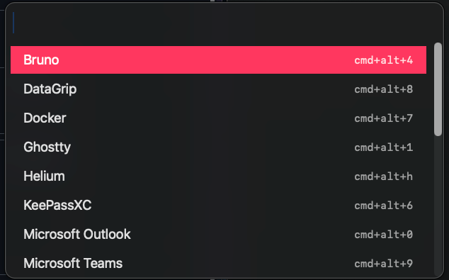
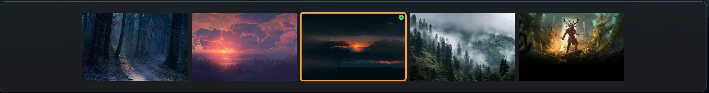

# Kipr

Keyboard-first macOS picker and hotkey daemon.

App picker (⌥+space):<br>


Wallpaper picker (⌥+space -> wallpaper):<br>


### Why does it exists?

I saw Omarchy picker and was actually amazed on how smoothly it worked. I love spotlight, but I also love mouse-less navigation.
So I tasked LLM to do something similar, also very opinionated, but working on macOS natively.

### What does it do

**App picker** is predefined app picker :) But - it also shows keymaps that are used to spawn/switch to these apps.

**Wallpaper picker** exists purely because I'm bored by wallpapers often, but I switch back to the ones I was already using :)

**Hotkey daemon** apart from monitoring for user-defined keymaps for apps it listens to combinations like ctrl+opt+h/l/enter for placing windows on screen.
See [Windows management](#window-management)

## Requirements

- macOS 26 or newer
- Swift 6.2 or newer (Xcode 26 or newer)

## Commands

```sh
make build   # compile
make bundle  # create build/Kipr.app and ad-hoc sign it
make run     # build the bundle and launch it
make test
make clean
```

The bundled app is an accessory/menu-bar application. Press `Option+Space` to toggle the picker; `Escape` closes it. Choose **Reload Config** from the status-menu to reload `~/.kipr/config.json` and apply changed actions or shortcuts. On first launch, bundled defaults are copied there; an existing `~/.kipr.json` is migrated automatically. The JSON `actions` object maps picker names directly to application, command, submenu, or wallpaper actions:

```json
{
  "actions": {
    "Ghostty": {
      "type": "application",
      "path": "/Applications/Ghostty.app",
      "shortcut": "cmd+alt+1"
    },
    "Lock screen": {
      "type": "command",
      "command": "pmset displaysleepnow"
    }
  }
}
```

The picker searches names only and displays the optional shortcut beside each name. Shortcuts configured for applications, commands, and window actions are registered globally, so they run without opening the picker. Shortcuts on submenus and wallpaper actions are display-only. Put wallpaper images in `~/.kipr/wallpapers`, select `Wallpaper`, and press `Enter` to apply one to all connected screens. Press `Escape` inside a submenu to go back; in the wallpaper picker it closes everything.

## Keyboard shortcuts

The picker shortcut defaults to `Option+Space` and can be changed with the top-level `pickerShortcut` object. Configured action shortcuts use a `+`-separated string, for example `cmd+alt+1`. Modifier names are `cmd`/`command`, `alt`/`option`, `ctrl`/`control`, and `shift`.

The following key names are hardcoded and accepted in shortcut strings:

| Keys       | Names                                            |
| ---------- | ------------------------------------------------ |
| Letters    | `a`–`z`                                          |
| Numbers    | `0`–`9`                                          |
| Navigation | `left`, `right`, `up`, `down`                    |
| Special    | `space`, `return`/`enter`, `escape`/`esc`, `tab` |

Inside the picker, `Up`/`Down` move the selection, `Return`/`Enter` activates it, and `Escape` goes back or closes the picker. In the wallpaper picker, `Left`/`Up` select the previous image and `Right`/`Down` select the next image; `Return`/`Enter` applies the selected image and `Escape` closes it.

## Window management

Window management is built in and does not need entries in `config.json`. These hardcoded global keymaps act on the focused window:

| Shortcut          | Action                       |
| ----------------- | ---------------------------- |
| `Ctrl+Alt+H`      | Move to the left half        |
| `Ctrl+Alt+L`      | Move to the right half       |
| `Ctrl+Alt+Return` | Maximize                     |
| `Ctrl+Alt+Cmd+H`  | Move to the previous display |
| `Ctrl+Alt+Cmd+L`  | Move to the next display     |

The built-in mappings replace any `window` actions with the same names when config loads, so they cannot currently be overridden or removed through `config.json`. `maximize` fills the usable screen area; the top-level `"windowGap"` (points, default 0) is applied to screen edges and between tiles.

```json
"windowGap": 8
```

Kipr needs Accessibility permission (System Settings → Privacy & Security → Accessibility); re-grant it if re-signing the bundle invalidates it.
